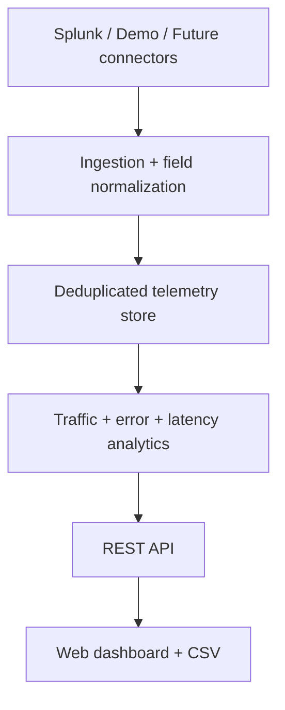

# Solution Monitoring Intelligence — working POC

A .NET 8 dashboard for cross-solution traffic, errors, usage classification, trends, monitoring confidence, findings, and CSV export. **Runs with realistic mock telemetry and no external credentials.** An optional read-only Splunk connector can import normalized events.

## Quick start

Requires Docker with Compose:

```bash
docker compose up --build
```

Open **http://localhost:8080**. API health: **http://localhost:8080/health**.

Or with the .NET 8 SDK:

```bash
cd src/Monitoring.Api
dotnet run --urls http://localhost:8080
```

## API

| Endpoint | Purpose |
|---|---|
| `GET /health` | Liveness |
| `GET /api/summary?days=30&environment=ALL` | KPIs |
| `GET /api/solutions?days=30&environment=PROD&sort=errorRate&search=Payment` | Per-solution metrics |
| `GET /api/trends?days=30&solutionId=solution-01` | Daily transactions/errors |
| `GET /api/findings?days=30` | Explainable risks and recommendations |
| `GET /api/sources` | Connector status |
| `GET /api/export.csv?days=30` | CSV download |
| `POST /api/splunk/sync` | Pull latest 24h from configured Splunk |

Time windows: 1–90 days. Environments: ALL, PROD, UAT. The demo has 20 registered solutions including high traffic, high errors, low traffic, zero observed traffic, and incomplete monitoring coverage.

## Splunk connection (optional)

1. Copy `.env.example` to `.env`.
2. Set `SPLUNK_URL` to the HTTPS management API base (usually port 8089); set a **read-only** `SPLUNK_TOKEN`.
3. Adapt `SPLUNK_SEARCH` to your indexes and field mappings. It must produce `event_id`, `solution_id`, `timestamp` (ISO-8601), `status_code`, `duration_ms`, `trace_id`.
4. Run `docker compose up --build`, then click **Sync Splunk now**.

The connector calls Splunk's `/services/search/jobs/export` with a 24h bounded window, JSON output, and a 100,000-result limit. Imported events are deduplicated by event ID and associated with a solution. New solution IDs are added to the inventory. Do not use a token with write privileges. Configure the Splunk search to return **one event per request** (not every log line), otherwise traffic and error rates will be misleading.

## Classification rules in this POC

- HIGH_TRAFFIC: >= 250 observed transactions/day.
- LOW_TRAFFIC: < 10 observed transactions/day, but > 0.
- ZERO_OBSERVED_TRAFFIC: no observed transactions **and verified instrumentation/source health**.
- UNKNOWN_USAGE: instrumentation or source health is insufficient, even if no events appear.
- HIGH_ERROR: at least 100 transactions and >= 5% 5xx failures.
- ERROR_VOLUME: >= 100 failures (unless already HIGH_ERROR).
- ERROR_RATE: 5xx / observed requests. 4xx excluded as not always server faults.
- P95: nearest-rank percentile of observed request durations.

**Caution:** These are example thresholds, not enterprise policy. Zero observed traffic is not proof a solution is unused. Sampling, trace duplication, ingestion gaps, and business transaction boundaries need verification.

## Architecture



## Current scope and known limitations

This is an **executable demonstration**, not a production monitoring platform. To minimize dependencies it uses an in-memory store and embedded static web UI. Seeded data is regenerated on restart; Splunk imports are not persisted. It does **not** yet implement PostgreSQL, Azure Monitor, Application Insights, Prometheus, OAuth/RBAC, scheduled ingestion, PDF export, distributed trace correlation, advanced pagination, source-level confidence scoring, or per-operation drilldown. The data is request-level and should not be interpreted as deduplicated end-to-end business transactions.

Before production use: persist aggregates and checkpoints, secure the sync endpoint with authentication/authorization, parameterize and validate approved Splunk searches, add rate limiting, enforce query cost limits, validate TLS/certificates, add integration tests, and establish an authoritative solution registry. The demo includes illustrative instrumentation coverage flags, not verified real coverage.

## Development validation

```bash
dotnet build src/Monitoring.Api/Monitoring.Api.csproj
# With the app running:
curl http://localhost:8080/health
curl 'http://localhost:8080/api/summary?days=30'
curl 'http://localhost:8080/api/solutions?days=7&sort=errors'
```

The environment used to package this POC did not have the .NET SDK, so a real compilation/runtime smoke test was not possible here.
